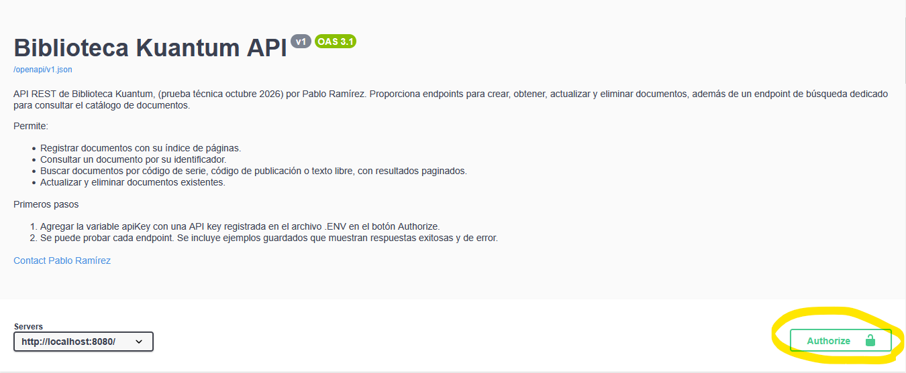
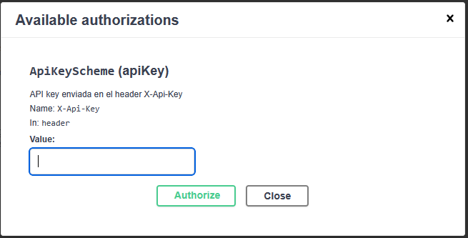
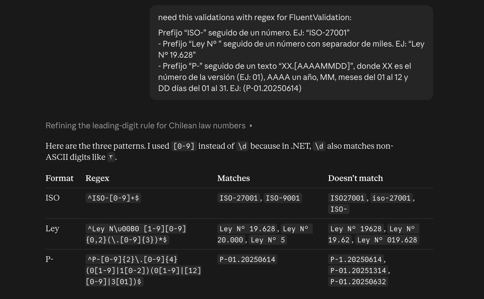
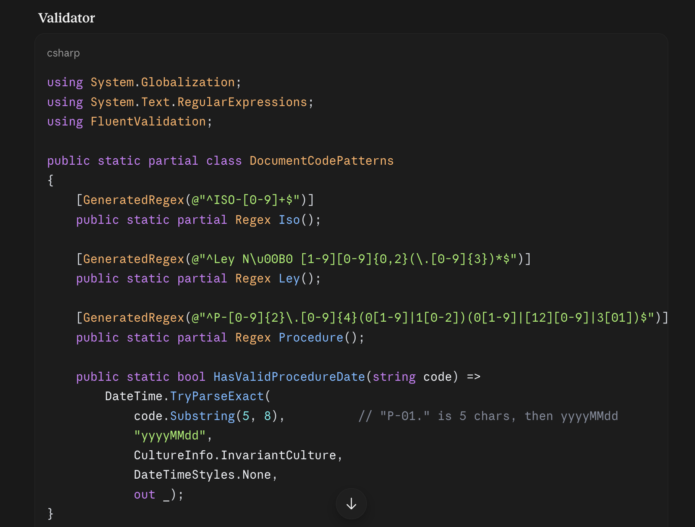
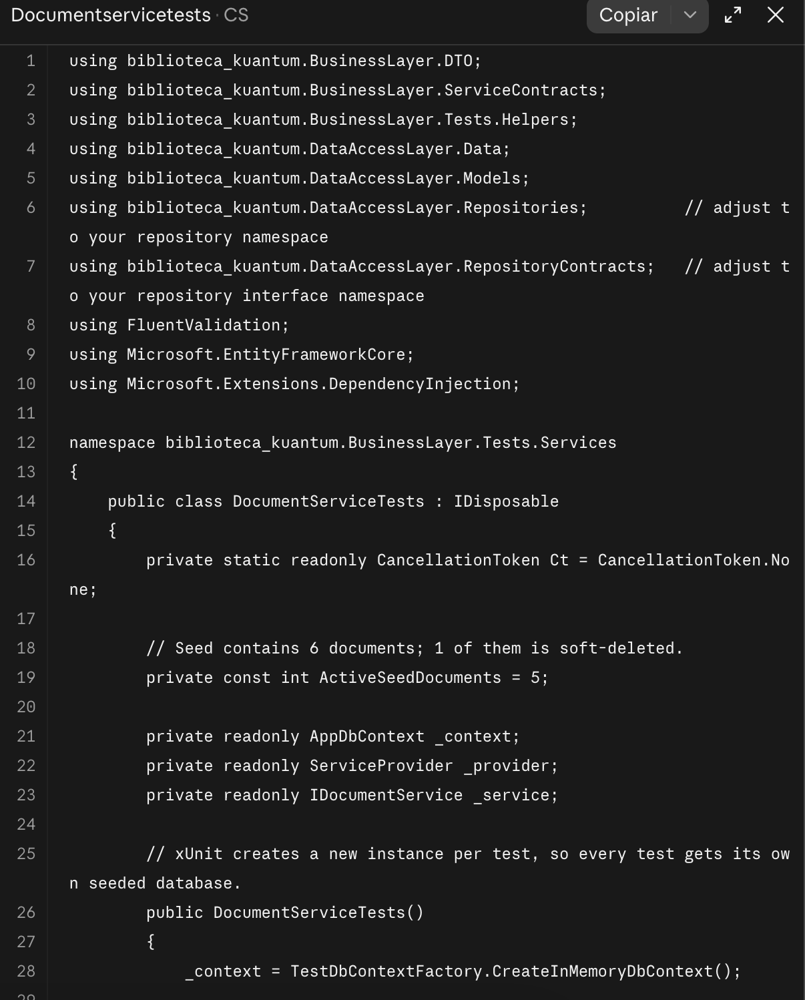
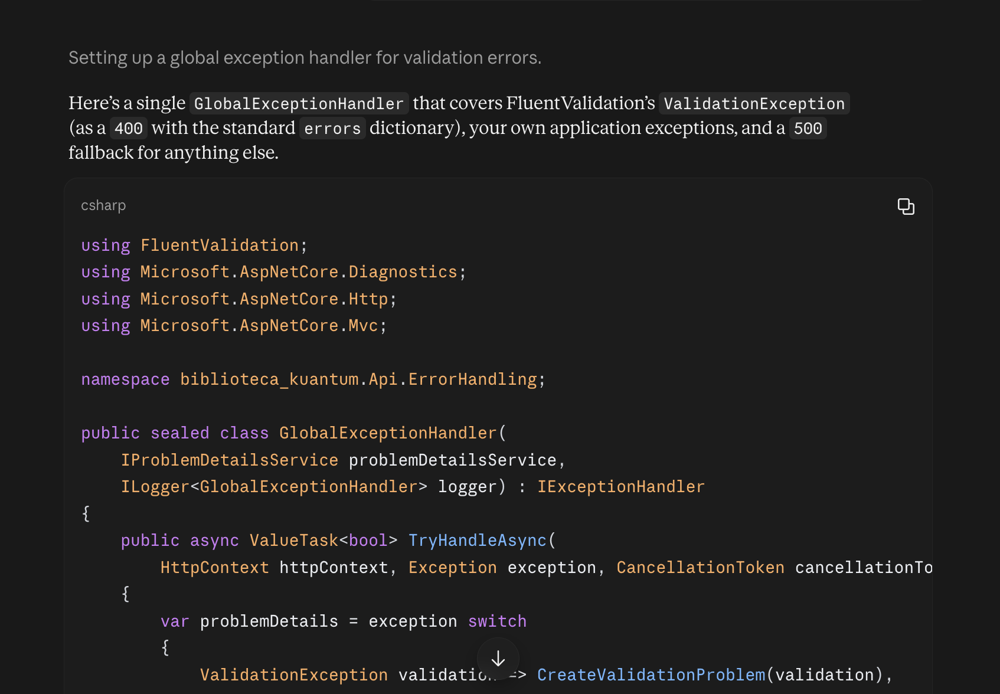
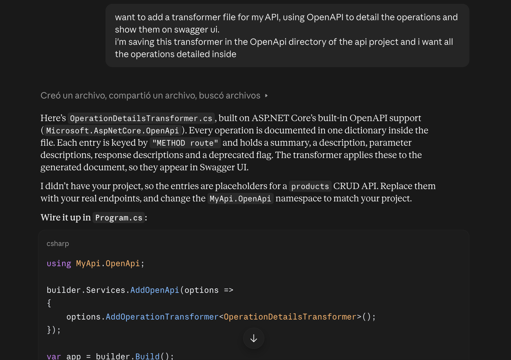

# Prueba Técnica de Postulación Kuantum - Pablo Ramírez

Desarrollo de API REST para la gestión de documentos (Biblioteca Kuantum), como parte de la prueba técnica del proceso de postulación de octubre de 2026 (/docs/prueba-tecnica.pdf/)

La API permite crear, consultar, buscar, actualizar y eliminar documentos, cada uno con su índice de páginas asociado, según los requerimientos especificados.

---

## Tabla de contenidos

- [Stack tecnológico](#stack-tecnológico)
- [Arquitectura](#arquitectura)
- [Ejecución con Docker](#ejecución-con-docker)
- [Ejecución local (desarrollo)](#ejecución-local-desarrollo)
- [Autenticación](#autenticación)
- [Endpoints](#endpoints)
- [Validaciones](#validaciones)
- [Manejo de errores](#manejo-de-errores)
- [Base de datos](#base-de-datos)
- [Pruebas](#pruebas)
- [Uso de AI](#uso-de-ai)
- [Supuestos y decisiones de diseño](#supuestos-y-decisiones-de-diseño)

---

## Stack tecnológico

| Área | Tecnología |
|---|---|
| Framework | .NET 10 / ASP.NET Core Web API |
| Base de datos | PostgreSQL 17 |
| ORM | Entity Framework Core + Npgsql |
| Validaciones | FluentValidation |
| Mapeo de objetos | AutoMapper |
| Documentación de la API | Swagger (Swashbuckle) |
| Pruebas | xUnit, EF Core InMemory |
| Contenedores | Docker y Docker Compose |
| Asistencia | Claude (asistente de IA) como apoyo durante el desarrollo |

---

## Arquitectura

La solución sigue una arquitectura clásica en capas, cada una con sus distintas responsabilidades:

```
Api  ──►  BusinessLayer  ──►  DataAccessLayer  ──►  PostgreSQL
```

| Proyecto | Responsabilidad |
|---|---|
| `biblioteca_kuantum.Api` | Controladores, configuración de la aplicación, inyección de dependencias y manejo global de excepciones. |
| `biblioteca_kuantum.BusinessLayer` | Servicios, DTOs, validaciones (FluentValidation) y perfiles de mapeo (AutoMapper). |
| `biblioteca_kuantum.DataAccessLayer` | Entidades, `AppDbContext`, configuraciones de EF Core, repositorios y migraciones. |
| `biblioteca_kuantum.BusinessLayer.Tests` | Pruebas unitarias e integración de los servicios. |

### Estructura del repositorio

```
biblioteca_kuantum/
├── docker-compose.yml
├── db/
│   └── init.sql                          # Esquema generado desde la migración de EF Core
├── src/
│   ├── biblioteca_kuantum.Api/
│   ├── biblioteca_kuantum.BusinessLayer/
│   └── biblioteca_kuantum.DataAccessLayer/
└── biblioteca_kuantum.BusinessLayer.Tests/
```

---

## Ejecución con Docker

**Requisito:** Docker Desktop (o Docker Engine con Docker Compose).

### 1. Clonar el repositorio

```bash
git clone <url-del-repositorio>
cd BibliotecaKuantum
```

### 2. Configurar las variables de entorno

El repositorio incluye un archivo `.env.example` con las variables que necesitan los contenedores. **Antes de levantar Docker**, cópialo con el nombre `.env` y completa los valores según el ejemplo:

```bash
# Linux / macOS / Git Bash
cp .env.example .env

# Windows (PowerShell)
Copy-Item .env.example .env
```

Luego edita `.env` y reemplaza los valores de ejemplo. Docker Compose lee este archivo automáticamente al iniciar.

### 3. Levantar los contenedores

```bash
docker compose up -d --build
```

Al iniciar:

1. Se levanta el contenedor de PostgreSQL y ejecuta `db/init.sql`, creando el esquema.
2. La API espera a que la base de datos esté disponible (healthcheck) y luego inicia.

| Recurso | URL |
|---|---|
| API | http://localhost:8080 |
| Swagger UI | http://localhost:8080/swagger |
| PostgreSQL | `localhost:5432` (usuario, contraseña y base de datos según lo definido en `.env`) |

Para detener los contenedores y **eliminar los datos** (la próxima ejecución vuelve a crear el esquema desde cero):

```bash
docker compose down -v
```


## Autenticación

La API utiliza una clave enviada en el encabezado `X-Api-Key` de cada solicitud. Esta se puede configurar en Swagger presionando en el botón Authorize y agregando nuestra Api Key definida en el arhivo .ENV para poder probar los distintos endpoints.




```http
X-Api-Key: <tu-clave>
```
---

## Endpoints

Se deja habilitada la ruta 

Ruta base: `/api/Documents`

| Método | Ruta | Descripción | Respuestas |
|---|---|---|---|
| `POST` | `/api/Documents` | Crea un documento junto con su índice de páginas. | `201 Created`, `400 Bad Request` |
| `GET` | `/api/Documents/{id}` | Obtiene un documento por su ID. | `200 OK`, `404 Not Found` |
| `GET` | `/api/Documents/search` | Busca documentos con filtros y paginación. | `200 OK`, `400 Bad Request` |
| `PUT` | `/api/Documents/{id}` | Actualiza los datos de un documento. | `200 OK`, `400 Bad Request`, `404 Not Found` |
| `DELETE` | `/api/Documents/{id}` | Elimina un documento (eliminación lógica). | `200 OK`, `404 Not Found` |

Ruta de Health Check: `/health` - Sin Autenticación

| Método | Ruta | Descripción | Respuestas |
|---|---|---|---|
| `GET` | `/health` | Entrega el estado (health) de la API. | `200 OK`, `503 Service Unavailable` |

Se utiliza la funcionalidad incorporada de IHealthCheckBuilder, para ahorrar complejidad de implementar una solución propia. se implementa mediante un endpoint creado con Minimal Api Endpoints y es mapeado a OpenAPI. se permite revisar sin autenticación.


### Crear un documento

`POST /api/Documents`

```json
{
  "name": "Política de Seguridad de la Información",
  "description": "Lineamientos de seguridad basados en la norma ISO 27001.",
  "authorFullName": "María José Fernández",
  "authorEmail": "mj.fernandez@example.com",
  "serialCode": "A1B2C3D4E5F60718",
  "publicationCode": "ISO-27001",
  "documentPages": [
    { "name": "Introducción", "page": 1 },
    { "name": "Alcance", "page": 3 },
    { "name": "Controles de Acceso", "page": 7 }
  ]
}
```

El documento y sus páginas se guardan en una única transacción. La fecha de creación (`createdAt`) la asigna la base de datos.

### Buscar documentos

`GET /api/Documents/search`

| Parámetro | Tipo | Descripción |
|---|---|---|
| `id` | `int` | Busca por ID exacto. |
| `serialCode` | `string` | Busca por código de serie exacto. |
| `publicationCode` | `string` | Busca por código de publicación exacto. |
| `searchText` | `string` | Busca coincidencias parciales, sin distinguir mayúsculas, en el nombre o el correo del autor. |
| `pageNumber` | `int` | Número de página. Por defecto `1`. |
| `pageSize` | `int` | Cantidad de resultados por página, entre `1` y `100`. Por defecto `10`. |

Los filtros se aplican por prioridad: si se envía `id`, se ignoran los demás; si no, se usa `serialCode`, luego `publicationCode` y por último `searchText`. Sin filtros, se listan todos los documentos activos.

Al no ser especificado, no se permite listar todos los documentos al enviar los campos de búsqueda vacíos.

Ejemplo: `GET /api/Documents/search?searchText=rojas&pageNumber=1&pageSize=10`

**Respuesta paginada:**

```json
{
  "items": [
    {
      "id": 3,
      "name": "Protección de la Vida Privada",
      "authorFullName": "Camila Rojas",
      "serialCode": "DEADBEEF00112233",
      "publicationCode": "Ley N° 19.628"
    }
  ],
  "totalCount": 2,
  "page": 1,
  "pageSize": 10,
  "totalPages": 1
}
```

---

## Validaciones

| Campo | Regla |
|---|---|
| `serialCode` | Obligatorio. Entre 1 y 16 caracteres hexadecimales (`0-9`, `A-F`). |
| `publicationCode` | Obligatorio. Debe cumplir uno de los tres formatos indicados abajo. |
| `authorEmail` | Formato de correo electrónico válido; máximo 100 caracteres. |
| `name` | Máximo 100 caracteres. |
| `description` | Máximo 1000 caracteres. |
| `documentPages` | Cada página debe tener un número de página mayor que 0. |

**Formatos de `publicationCode`:**

| Formato | Ejemplo | Regla |
|---|---|---|
| ISO | `ISO-27001` | Prefijo `ISO-` seguido de un número. |
| Ley | `Ley N° 19.628` | Prefijo `Ley N° ` seguido de un número con separador de miles. |
| Procedimiento | `P-01.20250614` | Prefijo `P-`, versión de dos dígitos y fecha `AAAAMMDD` válida (se rechazan fechas inexistentes como `20250230`). |

---

## Manejo de errores

Los errores se devuelven en formato **ProblemDetails** (RFC 9457) mediante manejadores globales de excepciones (`IExceptionHandler`), sin bloques `try/catch` en los controladores.

| Situación | Código |
|---|---|
| Datos de entrada inválidos | `400 Bad Request`, con el detalle de los errores por campo |
| Recurso inexistente o eliminado | `404 Not Found` |
| Error no controlado | `500 Internal Server Error`, sin exponer detalles internos |

Ejemplo de error de validación:

```json
{
  "type": "https://tools.ietf.org/html/rfc9110#section-15.5.1",
  "title": "One or more validation errors occurred.",
  "status": 400,
  "errors": {
    "PublicationCode": ["ISO-<number>, Ley N° <number> or P-XX.AAAAMMDD."]
  },
  "traceId": "00-..."
}
```

El campo `traceId` permite relacionar la respuesta con el registro correspondiente en los logs de la API.

---

## Base de datos

- El esquema se define con **Entity Framework Core** (migración `InitialCreate`) y se exporta a `db/init.sql`.
- PostgreSQL ejecuta `init.sql` automáticamente la primera vez que se crea el volumen de datos, por lo que la API no aplica migraciones al iniciar.
- Las tablas y columnas usan **snake_case** (`created_at`, `serial_code`) mediante `EFCore.NamingConventions`.
- `created_at` tiene como valor por defecto `now()` en la base de datos.
- La eliminación es **lógica** para los documentos: se registra la fecha en `deleted_at` y el documento deja de aparecer en todas las consultas (filtro global de EF Core). Las páginas asociadas se eliminan físicamente.

Para regenerar `init.sql` después de un cambio en el modelo:

```bash
dotnet ef migrations add <NombreMigracion> --project src/biblioteca_kuantum.DataAccessLayer --startup-project src/biblioteca_kuantum.Api
dotnet ef migrations script --project src/biblioteca_kuantum.DataAccessLayer --startup-project src/biblioteca_kuantum.Api -o db/init.sql
```

---

## Pruebas

```bash
dotnet test
```

Las pruebas cubren todos los métodos de `DocumentService` (crear, obtener, buscar, actualizar y eliminar), usando el servicio, repositorio, validaciones y mapeos reales sobre una base de datos **EF Core InMemory** con datos de prueba. Cada prueba utiliza una base de datos aislada.

La prueba de búsqueda por texto (`searchText`) está marcada como omitida: utiliza `ILIKE`, una función exclusiva de PostgreSQL que el proveedor InMemory no soporta. Se cubriría con una prueba de integración sobre PostgreSQL real (por ejemplo, con Testcontainers).

---

## Uso de AI

El uso de AI como apoyo para el desarrollo de la solución fue principalmente con el servicio [Claude de Anthropic](https://claude.ai), en su modalidad Chat y no de Agente vía Claude Code.

los principales usos de Claude fue en apoyar la creación de pruebas unitarias, validaciones (regex), error handling y la configuración de Open API:

### Fluent Validations Regex


### Unit tests

### Exception Handler

### Open API Transformers


---

## Supuestos y decisiones de diseño

- **`serialCode`:** el requisito indicaba una columna `VARCHAR(16)`, por lo que se aceptan códigos de hasta 16 caracteres hexadecimales, no exactamente 16.
- **Inicialización de la base de datos:** se eligió un script SQL generado desde la migración de EF Core para que el proyecto funcione con un solo `docker compose up`, sin requerir el SDK de .NET ni herramientas adicionales.
- **Eliminación lógica:** los documentos eliminados se conservan para trazabilidad; sus páginas se eliminan físicamente, ya que no tienen sentido sin el documento.
- **"No encontrado" no es una excepción:** los servicios devuelven `null` o `false` y el controlador responde `404`. Las excepciones se reservan para datos inválidos y errores inesperados.
- **Prioridad de filtros en la búsqueda:** los filtros no se combinan; se aplica el más específico enviado (`id` > `serialCode` > `publicationCode` > `searchText`), junto a eso, no se define un caso donde se podrían traer todos los documentos en una búsqueda vacía.

Se agradece la oportunidad de haber sido parte de este proceso.